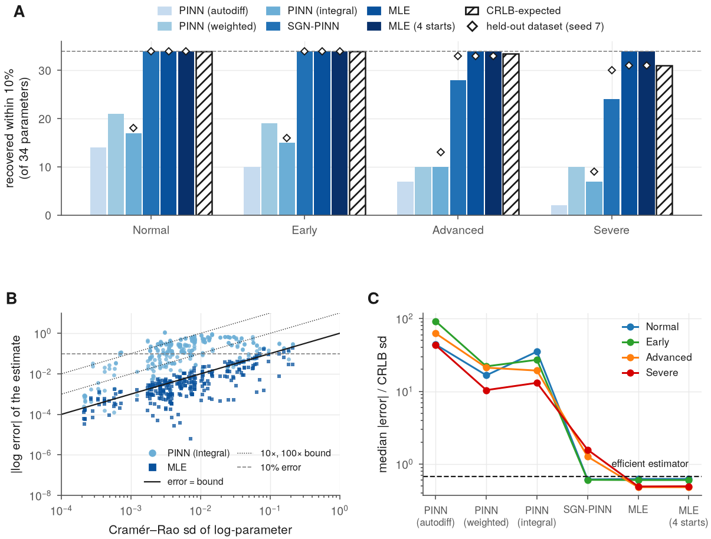
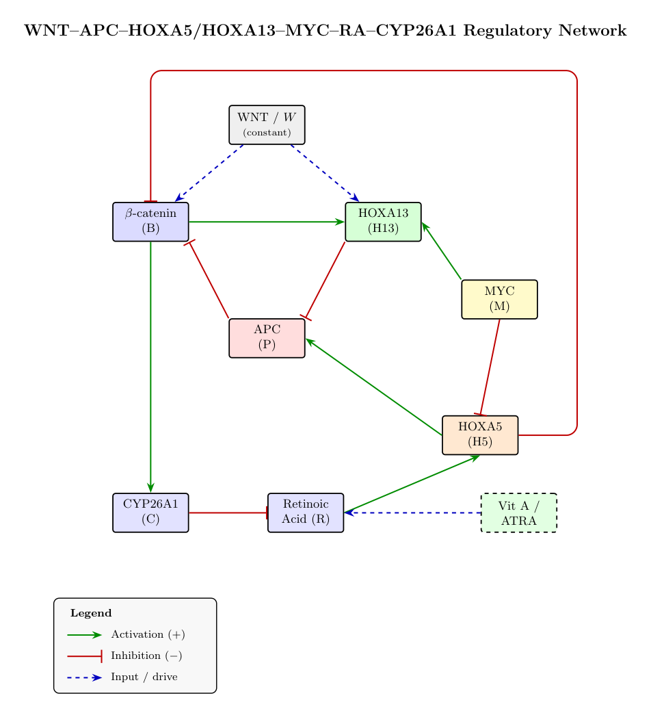
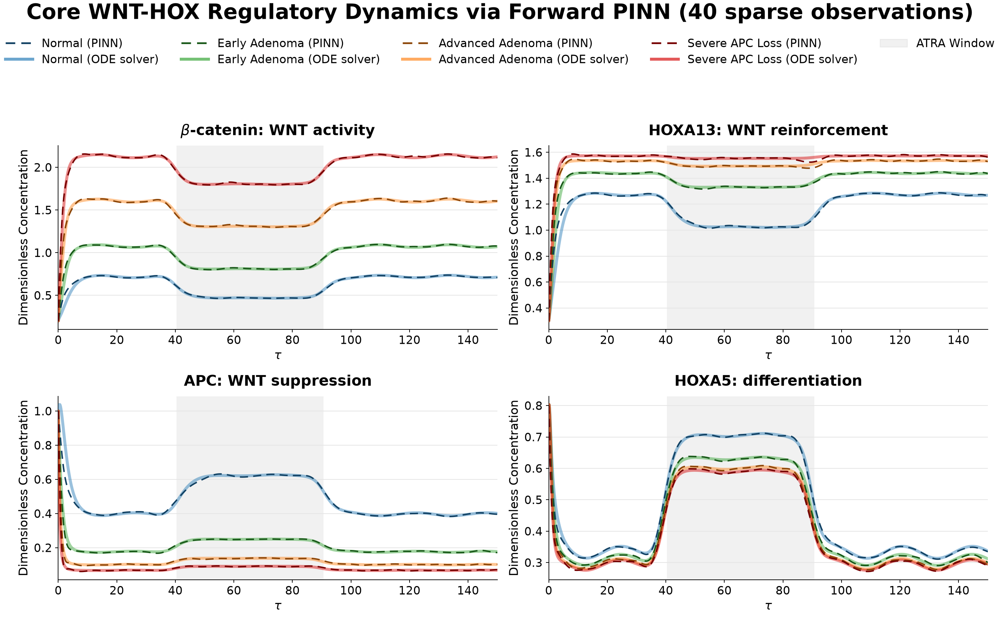
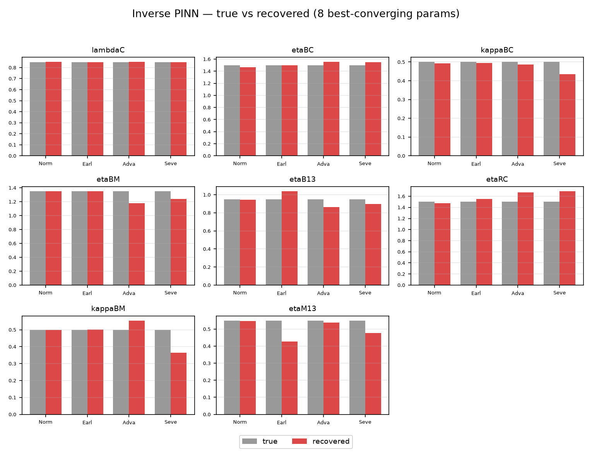
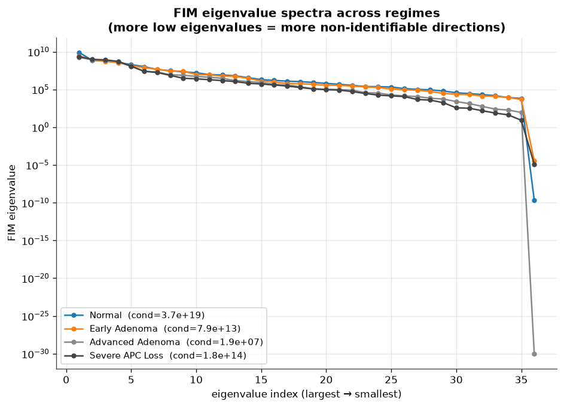
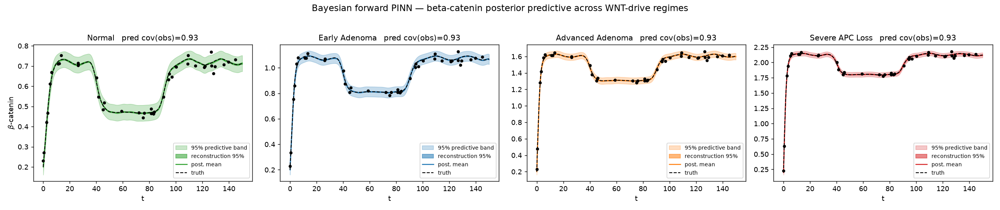
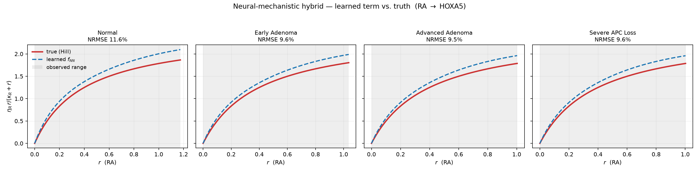
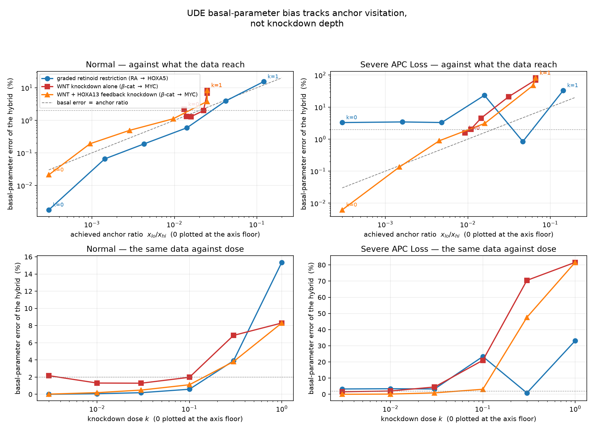

<div align="center">

# Estimator or experiment?

**A Cramér–Rao accounting of parameter recovery by physics-informed and hybrid
neural–mechanistic models of WNT–retinoic acid–HOX signalling in colorectal cancer**

[](https://github.com/aidxhxr/PINN-Research/actions/workflows/checks.yml)
[](pyproject.toml)
[](LICENSE)
[](LICENSE-CC-BY-4.0.txt)
[](paper/main.pdf)

[**Paper**](paper/main.pdf) ·
[**Reproduce**](paper/REPRODUCE.md) ·
[**Experiments**](experiments/) ·
[**Posters & slides**](publications/) ·
[**Docs**](docs/)

</div>

---

When a physics-informed neural network (PINN) or a neural–mechanistic hybrid
returns the wrong parameters, either the **estimator** failed or the
**experiment** never contained the information. The two call for opposite
remedies and are rarely told apart. This repository separates them with the
Cramér–Rao bound (CRLB) of the experiment actually performed, and carries that
accounting through a seven-state model of WNT, retinoic acid and HOX signalling,
from the healthy crypt to severe APC loss.

<p align="center">
  
</p>
<p align="center"><sub>
<b>The estimator gap.</b> (A) Parameters recovered within 10% of truth, out of 34,
in four disease regimes. (B) Error of each integral-PINN and maximum-likelihood
estimate against its Cramér–Rao standard deviation. (C) Median error in units of the bound: inverse PINNs sit
10–92× above it, maximum likelihood at 0.5–0.6 times it and SGN-PINN at
0.6–1.6 times (an efficient estimator: 0.67). Paper, Fig 5.
</sub></p>

## Findings

- **The information is there; the PINNs miss it.** Three inverse-PINN
  formulations recover 2–21 of 34 parameters per regime. The bound says an
  efficient estimator would recover 132.5 of 136 regime–parameter pairs, and a
  converged maximum-likelihood fit attains it on independent datasets where the
  data are informative. The PINNs' errors are 10–92 times the bound at the median.
- **SGN-PINN closes the gap where it converges.** A Schur-complement Gauss–Newton PINN freezes the
  network's features, so the problem becomes separable with a block-arrowhead
  structure. Wherever its continuation converges (both low-WNT regimes on two
  datasets), it matches the classical estimator and reports its own precision.
- **Where the bound is wide, change the experiment.** APC functionality, the
  parameter that defines the disease stage, loses three orders of magnitude of
  precision (the identifiable product it enters, 28-fold) as β-catenin
  saturates. One WNT knockdown restores it;
  information-matched conditions do not.
- **A learned term needs its anchor visited.** The constraint `f(0) = 0` of a
  learned regulatory term is informative only if some condition drives the
  regulator to zero, so the host equation's basal rate is lost under every
  network parameterisation tried. A knockdown that visits the anchor, in a
  condition that still contains the basal term, removes most of the loss.

## The model



Seven coupled ODEs for β-catenin, APC, HOXA5, HOXA13, MYC, retinoic acid and
CYP26A1, with circadian retinoic-acid forcing and an ATRA treatment pulse. The
inverse problem has 36 kinetic parameters, estimated from data under ten experimental
conditions (retinoid schedules plus WNT and MYC perturbations). WNT drive `W`
and APC functionality `θP` define four disease regimes:

| Regime | `W` | `θP` |
|---|---:|---:|
| Normal | 0.8 | 1.00 |
| Early adenoma | 1.0 | 0.75 |
| Advanced adenoma | 1.5 | 0.50 |
| Severe APC loss | 2.0 | 0.25 |

All data are synthetic, regenerated from fixed seeds against a Radau reference
solution. The equations and parameter tables are in the paper (Methods, S1 Table) and
[`src/wnt_pinn/model/`](src/wnt_pinn/model/); numerical conventions are in
[docs/model.md](docs/model.md).

<br clear="right">

## Repository layout

```text
.
├── paper/              Manuscript, figure scripts with audit files, reproduction map
├── experiments/        Seventeen self-contained experiments, in research order
├── src/wnt_pinn/       Shared model, networks, kernels, run manager and reporting
├── configs/            Experiment profiles for `wnt-pinn run`
├── results/            Result registry: metrics, source hashes and stated limits
├── artifacts/          Catalogue of preserved checkpoints and run outputs
├── publications/       Posters, slides, earlier manuscripts and figure sources
├── docs/               Installation, model, experiments, reproduction, decisions
├── scripts/            Experiment runner and kernel benchmarks
└── tests/              Numerical parity, scoring, integrity and resume tests
```

## Experiments

Each folder in [`experiments/`](experiments/) answers one question; all but the
protected baseline (05) have their own README with results, method and launch
commands.

| Phase | Experiments | What it established |
|---|---|---|
| Model and sensitivity | [01](experiments/01-model-prototypes/) · [02](experiments/02-original-pinn/) · [03](experiments/03-global-sensitivity/) | From the 27-state MATLAB model to the seven-state system; which parameters matter |
| Forward PINN | [04](experiments/04-forward-pinn/) | Fourier-feature PINN reproduces all seven states from 40 sparse observations (2.41% error) |
| Inverse-PINN ladder | [05](experiments/05-inverse-single-condition/) – [10](experiments/10-inverse-integral-residual/) | More conditions and state weighting lift PINN recovery from 26 to 50 of 144; a matched ablation credits the weighting, not the integral residual |
| Identifiability and uncertainty | [11](experiments/11-fisher-information/) – [14](experiments/14-bayesian-forward/) | Fisher information, an eight-parameter subproblem, Bayesian inverse and forward PINNs |
| Neural–mechanistic hybrids | [15](experiments/15-hybrid-ude/) | A learned term loses its host's basal rate; a knockdown that reaches the anchor restores it |
| Population extension | [16](experiments/16-population-extension/) | SciPy reproduction of a 14-state cell-population model under ATRA |
| Cramér–Rao bound and SGN-PINN | [17](experiments/17-sensitivity-pinn/) | The estimator gap, converged maximum likelihood and the Schur-complement Gauss–Newton PINN |

See [`experiments/README.md`](experiments/README.md) for every experiment's question, headline number and status.

<details>
<summary><b>More figures</b>: forward PINN, inverse recovery, Fisher spectra, Bayesian bands, learned terms, dose response</summary>
<br>

| | |
|:---:|:---:|
| <br><sub>Forward PINN (dashed) against the Radau reference (solid); shading marks ATRA treatment. [04](experiments/04-forward-pinn/)</sub> | <br><sub>The eight best-recovered parameters of an inverse-PINN run (a subset of 36). [10](experiments/10-inverse-integral-residual/)</sub> |
| <br><sub>Fisher-information eigenvalue spectra in the four regimes. [11](experiments/11-fisher-information/)</sub> | <br><sub>Posterior-predictive bands for β-catenin from HMC over network weights. [14](experiments/14-bayesian-forward/)</sub> |
| <br><sub>Learned RA→HOXA5 regulation with depletion conditions. [15](experiments/15-hybrid-ude/)</sub> | <br><sub>Basal-parameter error across depletion doses at fixed experimental effort. [15](experiments/15-hybrid-ude/)</sub> |

</details>

## Quick start

```bash
git clone https://github.com/aidxhxr/PINN-Research.git
cd PINN-Research
python3 -m venv .venv && source .venv/bin/activate
python -m pip install torch --index-url https://download.pytorch.org/whl/cpu
python -m pip install -e '.[ml,dev,publications]'

make check                 # ruff + the test suite (CPU, a few minutes)
wnt-pinn reproduce --all   # recompute every registered result from saved inputs
```

Regenerate a paper figure from its saved runs (no training):

```bash
PYTHONPATH=src python paper/figures/make_fig05.py
```

GPU setup, the TeX toolchain and training runs are covered in the
[installation](docs/installation.md) and [experiment](docs/experiments.md) guides.

## Reproducibility

- **Figures.** Every figure in the paper is drawn by `paper/figures/make_*.py`
  from saved run artifacts and writes an audit file listing each plotted number
  with the run it comes from. [`paper/REPRODUCE.md`](paper/REPRODUCE.md) maps
  figures and tables to scripts and runs.
- **Results.** [`results/registry.json`](results/registry.json) records the
  registered results (forward accuracy, inverse recovery, Fisher, Bayesian and
  hybrid checks, and the README figures) with their source hashes and
  limitations; `wnt-pinn reproduce` recomputes them, and CI runs it on every
  push to `main` and on pull requests. The paper's own numbers are traced by
  the figure audit files and `paper/REPRODUCE.md`.
- **Paths in the paper.** The manuscript cites repository paths as of the
  [`paper-v1`](https://github.com/aidxhxr/PINN-Research/tree/paper-v1) tag.
  The folders were renamed after that tag; [docs/layout.md](docs/layout.md)
  maps old paths to new ones.

## Publications

| | Authors | Files |
|---|---|---|
| **Paper.** Estimator or experiment? A Cramér–Rao accounting of parameter recovery by physics-informed and hybrid neural–mechanistic models | A. Aidarkhan, P. K. Kataboh | [PDF](paper/main.pdf) · [source](paper/) |
| **Poster.** Physics-Informed Neural Networks for Forward Modeling and Parameter Inference in a Reduced WNT-RA-HOX Model of Colorectal Cancer Initiation | N. Kim, A. Aidarkhan, P. K. Kataboh | [PDF](publications/posters/pinn-recovery/poster.pdf) · [source](publications/posters/pinn-recovery/) |
| **Poster.** Identifiability and Experimental Design for Neural-Mechanistic Hybrid Models Using Physics-Informed Neural Networks in Colorectal Cancer | A. Aidarkhan, P. K. Kataboh | [PDF](publications/posters/hybrid-models/poster.pdf) · [source](publications/posters/hybrid-models/) |

The earlier report, archived posters and the department talk are listed in
[`publications/`](publications/).

## Citation

```bibtex
@unpublished{aidarkhan2026estimator,
  title  = {Estimator or experiment? A {Cram\'er--Rao} accounting of parameter
            recovery by physics-informed and hybrid neural--mechanistic models
            of {WNT}--retinoic acid--{HOX} signalling in colorectal cancer},
  author = {Aidarkhan, Amirkhan and Kataboh, Pascal K.},
  year   = {2026},
  note   = {Manuscript. Code and data:
            \url{https://github.com/aidxhxr/PINN-Research/tree/paper-v1}}
}
```

Software citation metadata is in [`CITATION.cff`](CITATION.cff).

## License

Code is released under the [MIT License](LICENSE). The manuscript, posters,
slides, figures and documentation are licensed under
[CC BY 4.0](LICENSE-CC-BY-4.0.txt). Third-party material, such as the
Swarthmore College logo on the posters, remains with its owners.

## Contact

Amirkhan Aidarkhan, Department of Mathematics and Statistics, Swarthmore College ·
<aaidark1@swarthmore.edu>. Advisor: Pascal K. Kataboh.
